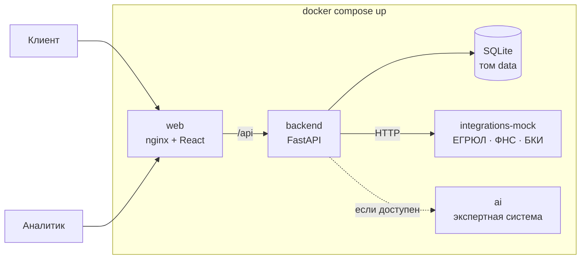

# XRONIX — умный кредитный кабинет предпринимателя

Прототип цифрового кредитного конвейера для малого и микробизнеса. Хакатон «Альфа-Будущее» 2026, кейс «Умный кредитный кабинет предпринимателя».

> **Версия к сдаче: `v1.0`.** Логика продукта целиком — в [docs/CONVEYOR.md](docs/CONVEYOR.md).

## Зачем

Предприниматель часто не знает, какой кредит ему подходит, повторно вводит одни и те же данные и не понимает, что происходит с заявкой. Банку нужно обрабатывать много разных заявок и тратить время специалиста только на нестандартные.

XRONIX связывает обе стороны в один процесс:
- **клиент** указывает ИНН — компания подтягивается из реестра; описывает потребность — система подбирает подходящие продукты и объясняет, почему другие не подходят; подаёт заявку и видит понятный статус: «что сейчас происходит» и «что нужно от вас»;
- **конвейер** сам проверяет данные, запрашивает внешние источники, считает балл и принимает решение там, где оно однозначно: одобрение, встречное предложение, запрос данных или отказ с причинами и альтернативами;
- **кредитный аналитик** получает только серую зону — с проверками, разложенным по факторам скорингом и рекомендацией системы;
- тем, у кого бизнеса ещё нет, **чат подбора бизнеса** помогает выбрать дело и посчитать план запуска, а демо-продукт «Старт» доводит путь до кредита.

Основной сценарий работает **без нейросети**: проверки, расчёты, скоринг и решения — правила на бэкенде. Чат подбора бизнеса и разбор фразы в мастере ведёт собственная экспертная система на правилах: словари, разбор текста и чисел, база знаний о городах из открытых источников и банк живых формулировок. Нейросети, ключей и внешних API в проверяемой версии нет. Кредитных решений система не принимает и денег не считает.

## Что входит в MVP

| Этап | Что умеет |
|---|---|
| Компания | ИНН с проверкой контрольной суммы → карточка из ЕГРЮЛ/ЕГРИП; роль заявителя; доверенность, если заявитель не руководитель |
| Потребность | мастер из трёх путей: кредит для текущего бизнеса, новая точка (с расчётом проекта), «пока нет бизнеса» (будущий ИП) |
| Подбор продукта | продукты XRONIX (демо) с условиями по публичным страницам банка, включая акцию — кредит с господдержкой до 50 млн ₽ без залога: «подходит» или «не подходит, потому что…», платёж и нагрузка |
| Заявка | заполнена из компании, потребности и продукта; черновик сохраняется; проверка полноты на клиенте и на сервере |
| Проверки | полнота и корректность, ЕГРЮЛ/ЕГРИП, «Прозрачный бизнес» ФНС, БКИ — смоделированные интеграции |
| Скоринг и решение | балльная карта 0–100 с объяснением каждого балла; решение отдельно от скоринга; версия правил в каждом решении |
| Исходы | автоодобрение, встречное предложение, запрос данных, ручное рассмотрение, отказ с причинами и тем, что можно сделать |
| После решения | принятие условий → подписание → выдача (симуляция) с графиком платежей |
| Аналитик | очередь по времени ожидания, карточка заявки, решение с проверками, сводка |
| Сопровождение | журнал всех переходов, лента событий клиента |
| Чат подбора бизнеса | сфера → город → свои деньги → план запуска по шаблонам и формулам |

**Не входит** (сознательные упрощения, кейс с. 11):
- настоящие интеграции с ФНС, БКИ и системами банка — только моки с тем же смыслом;
- настоящая электронная подпись и перевод денег — симуляция внутри продукта;
- залоговая экспертиза, юристы, комплаенс, несколько уровней одобрения — один аналитик;
- «Бизнес-ипотеку» и «Кредитную линию» показываем в подборе, заявку оформляем на кредиты одной суммой;
- почта, SMS и мессенджеры не участвуют в сценарии — все уведомления в ленте кабинета.

## Качество чата

Сервис `ai` — система правил без нейросети. Метрики на собственных наборах команды (сгенерированные по шаблонам и ручной набор) — 0,98–1,00. На независимом синтетическом наборе из 48 фраз, написанном внешним ИИ и не виденном разработчиками правил, чат понял первую реплику верно в 83% случаев (20 из 24), а разбор потребности в деньгах — в 71% (17 из 24); всего 77%. Выборка небольшая, фразы синтетические, многоходовый диалог не оценивался. Подробности и список ошибок — в [docs/reports/ROUND4_eval_result.md](docs/reports/ROUND4_eval_result.md).

## Быстрый запуск

### Требования

- Docker Engine 24+ с Docker Compose v2 (Linux, macOS или Windows с Docker Desktop);
- свободный порт `8080`;
- память и диск: нейросети в составе нет, требования скромные. Замер чистого запуска на Windows 11 (Docker Desktop, пустой Docker: 0 образов и 0 кэша сборки), 22 октября 2026, ветка `backend` @ `469c508`:
  - от клонирования до готовности всех четырёх сервисов (`healthy`): **158,84 с ≈ 2 мин 39 с** (`git clone` 4,97 с, `docker compose up -d --build --wait` 153,87 с; сюда входят загрузка базовых образов, установка зависимостей и сборка фронтенда, установка Docker не входит);
  - память четырёх контейнеров в покое: **147,8 МиБ** (110,5 МиБ без сервиса `ai`);
  - образы: backend 243 МБ, integrations-mock 214 МБ, ai 202 МБ, web 75,8 МБ; все образы на диске 381,2 МБ (общие слои считаются один раз), кэш сборки 877,2 МБ;
  - перезапуск сервиса `ai` до `healthy`: 6,05 с;
  - машина: Intel Core i5-13420H (8 ядер, 12 потоков), 15,7 ГБ памяти (Docker видит 7,6 ГиБ), Docker Desktop 4.96.2, Compose v5.6.1;
  - сырые файлы и SHA-256: [отчёт](docs/reports/ROUND4_windows_danya.md), [артефакты](docs/reports/artifacts/ROUND4_windows_danya/);
  - на «чистой» Windows Docker Desktop требует включённых компонентов «Virtual Machine Platform» и WSL 2 (установка: `wsl --install --no-distribution` от администратора и перезагрузка). Это не входит в замер;
- браузер: свежие Chrome, Firefox, Safari или Edge.

Интернет нужен только при первой сборке образов. Платные ключи и учётные записи внешних сервисов не нужны.

### Запуск

```sh
git clone https://github.com/xrnskew/XRONIX.git
cd XRONIX
docker compose up --build
```

Первый запуск дольше остальных: собираются четыре образа. Дождитесь, пока `docker compose ps` покажет все сервисы `healthy`. Демо-данные засеваются при первом старте и сохраняются в томе `backend-data`.

Откройте:
- http://localhost:8080 — презентация проекта;
- http://localhost:8080/app — рабочая версия кабинета (клиент и аналитик входят здесь);
- http://localhost:8080/docs — Swagger API.

Демо-данные засеваются при первом запуске. Сбросить всё к началу: `docker compose down -v` и снова `docker compose up`.

### Демо-учётки

| Роль | Почта | Пароль | Что внутри |
|---|---|---|---|
| Клиент | `client@xronix.demo` | `demo12345` | компании и заявки во всех статусах |
| Кредитный аналитик | `analyst@xronix.demo` | `demo12345` | очередь заявок на ручном рассмотрении |

Новый клиент может зарегистрироваться сам. Зарегистрироваться аналитиком нельзя.

## Сценарий проверки (~10 минут)

1. Откройте http://localhost:8080/app и зарегистрируйте нового клиента.
2. **Автоодобрение.** «Новая заявка» → «Кредит для текущего бизнеса» → ИНН `7715881399` (ООО «Северная выпечка»), роль «Генеральный директор» → цель «Купить оборудование», 1 500 000 ₽ на 24 мес. → подбор → «Кредит одной суммой без залога» → заполните финансы (выручка 24 000 000 ₽, расходы 19 200 000 ₽, платежи по кредитам 40 000 ₽/мес.) и согласие на запрос в БКИ → «Подать».
   Статус меняется сам: проверки → оценка → «Одобрено», платёж 78 933 ₽/мес. «Принять» → «Подписать» → «Деньги выданы» с графиком платежей.
3. **Встречное предложение.** Ещё одна заявка: ИНН `777309114120` (ИП Лебедев), «Пополнить оборотные средства», 2 000 000 ₽ на 24 мес., выручка 14 400 000 ₽, расходы 10 600 000 ₽, платежи 85 000 ₽/мес. Нагрузка выходит около 60% — система предлагает более долгий срок и объясняет почему.
4. **Отказ с объяснением.** ИНН `7755761690` (ООО «Ромашка Трейд», просрочка 90+) или `776846978815` (ИП Соколова, работает 5 месяцев) — отказ с причинами и тем, что можно сделать.
5. **Аналитик.** Выйдите и войдите `analyst@xronix.demo`. В очереди — заявки, которые система не решила сама. Откройте «Вектор Логистик» (12 млн ₽): проверки, скоринг по факторам, рекомендация. Примите решение — например, встречное предложение с другой суммой и комментарием.
6. **Решение глазами клиента.** Войдите `client@xronix.demo` — решение аналитика видно в заявке и в ленте.
7. **Пока нет бизнеса.** «Подбор бизнеса» → «Хочу открыть пекарню», город Самара, своих денег 900 000 ₽ → план запуска → «Подобрать кредит» → будущий ИП по личному ИНН `772519083310` → продукт «Старт» → одобрение с условием зарегистрировать ИП до подписания.
8. **Господдержка.** Новая заявка «Северной выпечки», «Купить оборудование», 40 000 000 ₽ на 36 мес. без залога → подходит только «Кредит с господдержкой»: половину риска берёт Корпорация МСП. В скоринге — фактор «Поручительство Корпорации МСП» (+8). Сумма больше 5 млн ₽, поэтому заявка уходит специалисту.

### Компании-сценарии

Все компании и люди выдуманы. ИНН проходят контрольные суммы ФНС.

| ИНН | Компания | Исход |
|---|---|---|
| `7715881399` | ООО «Северная выпечка», 4 года, чистая история | автоодобрение |
| `777309114120` | ИП Лебедев, кофейни, нагрузка выше 50% | встречное предложение: дольше срок |
| `7768151886` | ООО «Вектор Логистик», 12 млн ₽ под залог | ручное рассмотрение аналитиком |
| `7755761690` | ООО «Ромашка Трейд», просрочка 90+ | отказ, стоп-фактор |
| `776846978815` | ИП Соколова, 5 месяцев работы | отказ: стаж меньше 9 месяцев, альтернативы |
| `7772731777` | ООО «Альфа-Сервис Плюс», массовый адрес | запрос доверенности, если заявитель не руководитель |
| `772519083310` | будущий ИП, личный ИНН | «Старт» с условием регистрации ИП |

Любой другой корректный ИНН тоже работает: мок выдаёт для него детерминированную синтетическую компанию, и конвейер проходит до конца.

## Архитектура



Подробно — [docs/ARCHITECTURE.md](docs/ARCHITECTURE.md): компоненты, путь заявки по конвейеру, диаграмма состояний, модель данных, безопасность и надёжность.

| Сервис | Папка | Технологии | Назначение |
|---|---|---|---|
| `web` | [`frontend/`](frontend) | React 19, TypeScript, Vite, Tailwind, nginx | кабинет клиента `/app`, рабочее место аналитика `/app#/bank`, презентация `/` |
| `backend` | [`backend/`](backend) | Python 3.12, FastAPI, SQLAlchemy, SQLite | машина состояний заявки, проверки, скоринг и решение, роли, лента, чат, расчёт проекта |
| `integrations-mock` | [`integrations-mock/`](integrations-mock) | Python 3.12, FastAPI | смоделированные ЕГРЮЛ/ЕГРИП, «Прозрачный бизнес», БКИ |
| `ai` | [`ai/`](ai) | Python 3.12, FastAPI, правила и словари | экспертная система: диалог чата подбора бизнеса и разбор фразы в мастере; база знаний о 100 городах (Росстат, OpenStreetMap) и банк фраз; без сервиса всё работает по запасному пути |
| контракты | [`contracts/`](contracts) | JSON Schema, Ajv | форматы всех запросов и ответов, правила скоринга, справочники |

## Скоринг и решение

Скоринг и кредитное решение — два разных модуля (кейс, с. 14–15):

1. **Стоп-факторы** — сразу отказ: ликвидация или банкротство, стаж меньше 9 месяцев, просрочка 90+ за год, недоимка больше 100 000 ₽, дисквалификация руководителя.
2. **Балльная карта** 0–100 от стартовых 50: стаж, долговая нагрузка, кредитная история, сумма к выручке, залог, массовый адрес, недоимка, отрасль. Классы A ≥ 75, B 60–74, C 45–59, D < 45.
3. **Решение** по классу, нагрузке, сумме и продукту: A до 5 млн ₽ и нагрузка до 50% — одобрение; нагрузка выше 50% — встречное предложение (дольше срок или меньше сумма); B, C и крупные суммы — аналитику с рекомендацией; D — отказ.

Пороги, баллы и надбавки к ставке синтетические и лежат в одном файле [`contracts/rules/credit_rules.v1.json`](contracts/rules/credit_rules.v1.json). Версия правил сохраняется в каждом решении. Полная таблица — [docs/CONVEYOR.md, раздел 6](docs/CONVEYOR.md#6-скоринг-и-решение).

## Конфигурация и переменные окружения

Значения по умолчанию в `docker-compose.yml` подобраны так, что для проверки ничего настраивать не нужно.

**`web`** (аргументы сборки образа, `frontend/Dockerfile`)

| Переменная | По умолчанию | Назначение |
|---|---|---|
| `VITE_USE_MOCKS` | `false` | `true` — фронт на встроенных моках, без бэкенда |
| `VITE_CSP_ALLOW_HTTP` | `true` в образе | убирает `upgrade-insecure-requests` из CSP, чтобы сайт открывался по http не только с localhost |

**`backend`**

| Переменная | По умолчанию в compose | Назначение |
|---|---|---|
| `SEED_DEMO` | `true` | засеять демо-учётки и заявки при первом запуске; повторный старт ничего не дублирует |
| `CORS_ORIGINS` | `http://localhost:8080` | адреса сайта через запятую; запись по cookie принимается только с них |
| `JWT_SECRET` | пусто | пусто — ключ создаётся в томе `data` и сохраняется между перезапусками |
| `JWT_EXPIRE_MINUTES` | `1440` | срок сессии |
| `DATABASE_URL` | SQLite в томе `data` | строка подключения SQLAlchemy |
| `INTEGRATIONS_URL` | `http://integrations-mock:8002` | адрес моков проверок |
| `MOCK_AI` | `false` | `false` — ходить в сервис `ai` |
| `CONSULT_CHAT` | `true` | чат подбора бизнеса через `/ai/consult`; если сервис недоступен, бэкенд ведёт запасной диалог сам |
| `AI_SERVICE_URL` | `http://ai:8001` | адрес сервиса `ai` |
| `AUTH_REQUESTS_PER_MINUTE`, `API_REQUESTS_PER_MINUTE`, `AI_REQUESTS_PER_MINUTE` | 20 / 120 / 6 | ограничения частоты запросов |

**`integrations-mock`**

| Переменная | По умолчанию | Назначение |
|---|---|---|
| `FAIL_INN` | пусто | ИНН, для которого мок отвечает `503`: показывает, что сбой интеграции не ломает конвейер, а отправляет заявку аналитику |

**`ai`** — ключей и настроек не требует: ни GigaChat, ни сети во время работы. Пересборка базы фактов и банка фраз (только при разработке) — [`ai/knowledge/README.md`](ai/knowledge/README.md); `GIGACHAT_AUTH_KEY` нужен только скрипту `generate_phrases.py`, в образ он не попадает.

## API

- Контракты: [`contracts/conveyor.md`](contracts/conveyor.md) — заявки, компании, подбор, лента, рабочее место аналитика; [`contracts/api.md`](contracts/api.md) — учётки, чат, планы; [`contracts/integrations.md`](contracts/integrations.md) — моки; [`contracts/ai.md`](contracts/ai.md) — модель.
- JSON Schema всех тел — [`contracts/schemas/`](contracts/schemas), примеры — [`contracts/examples/`](contracts/examples).
- Swagger: http://localhost:8080/docs, OpenAPI: http://localhost:8080/openapi.json.
- Выгрузка [`contracts/openapi.json`](contracts/openapi.json) и коллекция запросов [Bruno](https://www.usebruno.com) [`contracts/collection/`](contracts/collection): основной сценарий без интерфейса — клиент до выдачи, аналитик по «Вектору», заявка с господдержкой. Запуск и подготовка базы — [`contracts/collection/README.md`](contracts/collection/README.md).

## Тесты

```sh
cd frontend && npm ci && npm test && npm run build    # фронт: правила, расчёт проекта, сессия, моки
cd contracts && npm ci && npm run check               # примеры проходят схемы, справочники и аннуитет сходятся
cd backend && pip install -r requirements-dev.txt && python -m pytest -q   # бэкенд: конвейер, проверки, скоринг, роли
```

## Разработка без Docker

```sh
# моки проверок, порт 8002
cd integrations-mock && python3 -m venv .venv && .venv/bin/pip install -r requirements.txt && .venv/bin/uvicorn app.main:app --port 8002
# бэкенд, порт 8000
./backend/run.sh
# фронт, порт 5173; /api проксируется на 8000
cd frontend && npm ci && VITE_USE_MOCKS=false npm run dev
```

Фронт без бэкенда: `npm run dev` в `frontend/` — работает на встроенных моках с теми же форматами ответов, демо-учётки те же.

## Данные

Все данные о клиентах, компаниях, руководителях, документах, заявках и финансах синтетические (кейс, с. 10). В интерфейсе все кредитные продукты называются «продукт XRONIX (демо)»: названия и ссылки банка в интерфейсе не показываем. Условия смоделированы по датированному снимку публичных страниц alfabank.ru (источники и дата — в [THIRD_PARTY_NOTICES.md](THIRD_PARTY_NOTICES.md), раздел 5), это учебный расчёт, а не оферта банка. Сторонние компоненты, модели, данные и смоделированные интеграции — [THIRD_PARTY_NOTICES.md](THIRD_PARTY_NOTICES.md).

## Версия на дедлайн

Версия на дедлайн — тег `v1.0`, коммит кода `03db44c`. Сайт: [xronix.ru](https://xronix.ru), API: `https://api.xronix.ru`. После этого коммита в `main` добавлены только изменения README.

## Команда

| Кто | Роль | Папка |
|---|---|---|
| Александр | капитан, контракты, фронт | `frontend/`, `contracts/` |
| Илья | бэкенд, моки, запуск | `backend/`, `integrations-mock/` |
| Даня | экспертная система, база знаний, датасеты | `ai/` |
