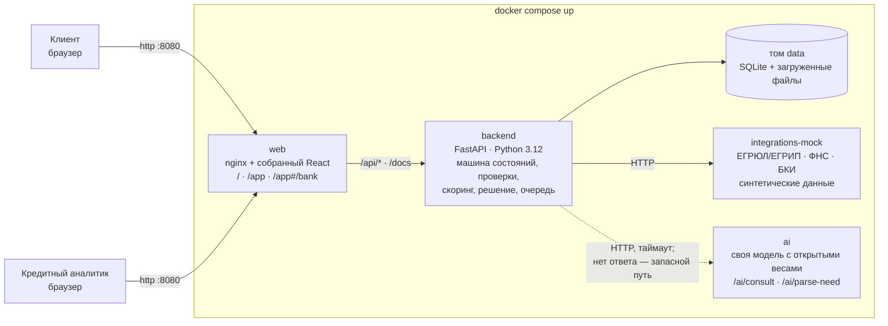
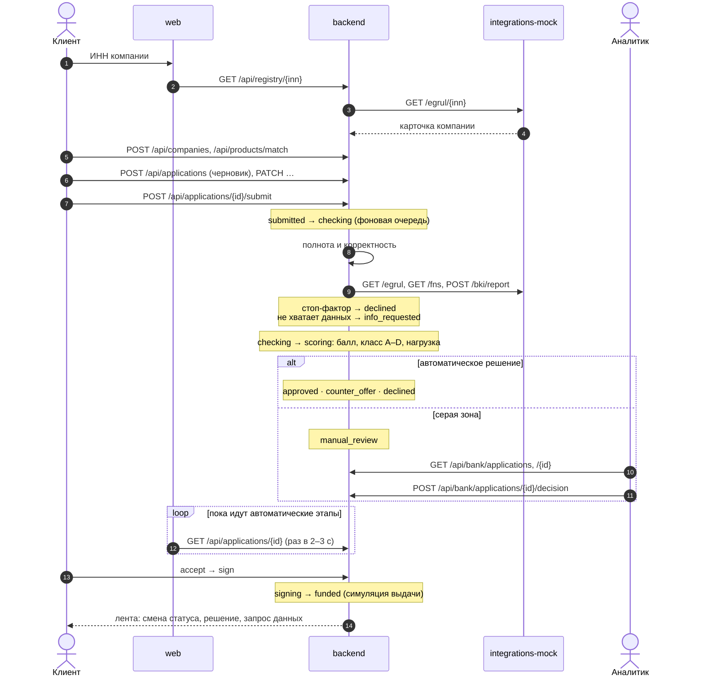
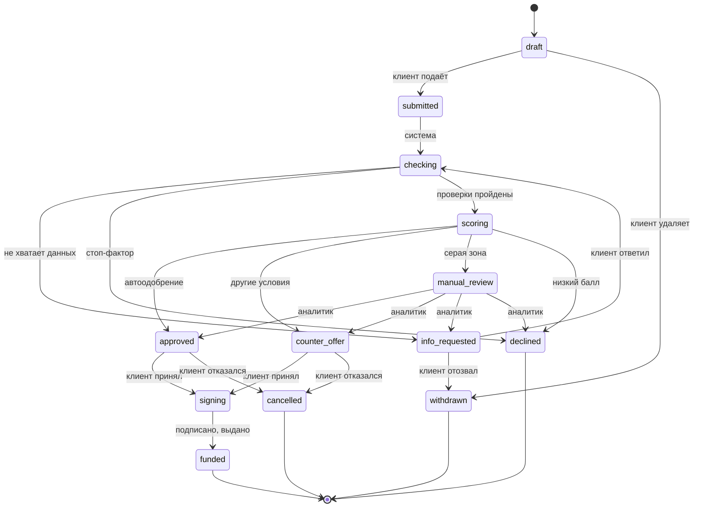
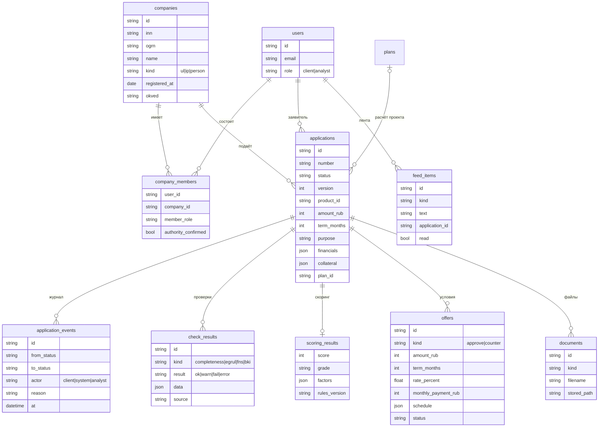

# Архитектура XRONIX

> Черновик к сдаче (раунд 2). Логика продукта подробно — в [CONVEYOR.md](CONVEYOR.md), точные форматы — в [`contracts/`](../contracts).

## 1. Компоненты

| Сервис | Папка | Технологии | Порт в сети compose | Что делает |
|---|---|---|---|---|
| `web` | `frontend/` | React 19, Vite, TypeScript, Tailwind; nginx | 8080 (наружу) | Раздаёт фронт, проксирует `/api`, `/docs`, `/openapi.json` в `backend` |
| `backend` | `backend/` | FastAPI, SQLAlchemy, SQLite, PyJWT | 8000 | Учётки и роли, заявки и машина состояний, проверки, скоринг, решение, рабочее место аналитика, лента, чат подбора бизнеса, расчёт проекта |
| `integrations-mock` | `integrations-mock/` | FastAPI | 8002 | Моки ЕГРЮЛ/ЕГРИП, «Прозрачного бизнеса» ФНС и БКИ по контракту [`integrations.md`](../contracts/integrations.md) |
| `ai` | `ai/` | FastAPI, Qwen3-1.7B + LoRA (в работе) | 8001 | Диалог чата и разбор фразы в мастере. Кредитных решений не принимает и денег не считает |

Принципы:
- **Основной сценарий работает без модели.** Если `ai` не ответил за таймаут, бэкенд ведёт чат по запасному диалогу, а мастер заполняется руками.
- **Внешние системы — отдельным сервисом по HTTP.** Моки заменяются настоящими интеграциями без правок конвейера. Если мок недоступен, проверка получает статус `error`, и заявка уходит аналитику, а не падает.
- **Правила — данными, а не кодом.** Пороги скоринга и решения лежат в [`credit_rules.v1.json`](../contracts/rules/credit_rules.v1.json). Версия правил сохраняется с каждым решением.
- **Один источник правды о форматах.** Схемы JSON в `contracts/schemas`; примеры проверяются `npm run check`, ответы бэкенда — тестами по тем же схемам.

## 2. Как заявка проходит конвейер

## 3. Состояния заявки

Переходы делает только машина состояний на бэкенде. Недопустимый переход — `409 INVALID_TRANSITION`, устаревшая `version` — `409 VERSION_CONFLICT`. Каждый переход пишется в журнал `application_events`: откуда, куда, кто, причина, время. Тексты статусов для клиента — в [`dictionaries.json`](../contracts/dictionaries.json).

## 4. Модель данных

Кроме этого: `plans` (расчёт проекта), чаты и генерации ответов, сессии, токены восстановления пароля. Миграции версионные, применяются при старте бэкенда.

## 5. Безопасность и надёжность

- Сессия — HttpOnly cookie `SameSite=Strict`, на https — `Secure`. Запись по cookie принимается только с `Origin` из `CORS_ORIGINS`.
- Пароли — PBKDF2-SHA256, 600 000 итераций. Токен восстановления одноразовый, 15 минут. Ограничение частоты запросов на вход и к ИИ.
- Роли: все `/api/bank/*` только для `analyst`, остальным — `404` («чужое не существует»). Аналитик не меняет данные клиента, только принимает решение; всё попадает в журнал.
- Загрузки — до 5 МБ, проверяются на сервере, хранятся в томе `data` рядом с базой, не в каталоге сайта.
- Конкурентные решения защищены `version` заявки.
- Сбой мока или модели не останавливает конвейер: проверка с `error` уходит аналитику, чат — на запасной диалог.
- nginx: `X-Content-Type-Options`, `X-Frame-Options: DENY`, `Referrer-Policy`; во фронте — CSP.

Для продакшена: SQLite заменяется на PostgreSQL без изменения API (модели на SQLAlchemy), фоновая очередь — на брокер, моки — на настоящие интеграции за тем же HTTP-контрактом. Прод-конфигурация с Caddy и резервными копиями — в `backend/deploy/`.
