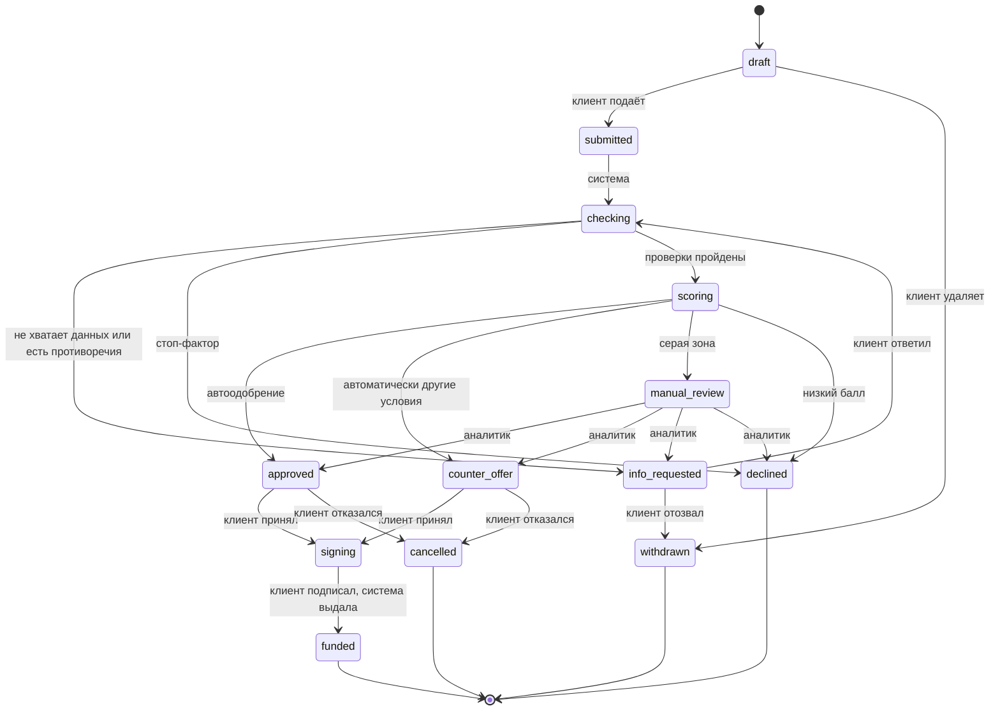
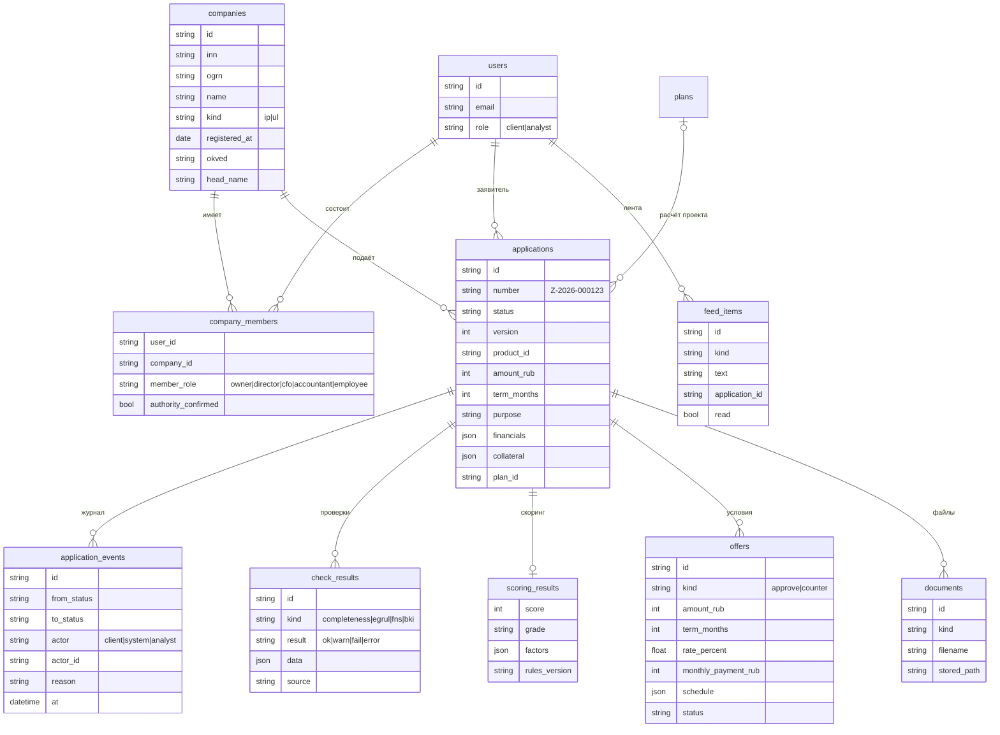
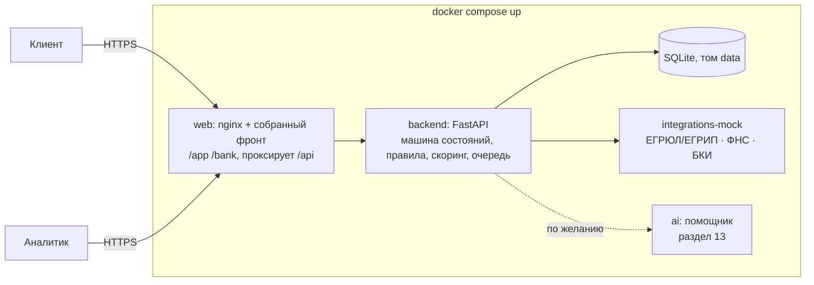

# XRONIX v2 — кредитный конвейер без ИИ

Проект основы продукта под кейс «Умный кредитный кабинет предпринимателя». Документ для всей команды: по нему пишем контракты в `contracts/` и раздаём задачи по раундам.

Принцип: **основной сценарий целиком работает без нейросети.** Все проверки, расчёты, скоринг и решения делаются правилами на бэкенде. ИИ потом добавляется сверху как помощник (раздел 13) и ничего не ломает, если недоступен. Это прямое требование кейса (с. 9: дополнительные механики «не заменяют работоспособность основного сценария»).

Сроки: дедлайн 26 октября. Раунды в разделе 14.

---

## 1. Что входит в MVP и что нет

Кейс просит выбрать реалистичный MVP и объяснить границы (с. 8, рекомендация 02).

**Входит:**
- кабинет клиента: компания по ИНН → потребность → подбор продукта → заявка → статус → решение → подписание → выдача (симуляция);
- расчёт проекта для цели «новая точка или направление» (наш текущий план, но по шаблонам и формулам);
- автоматические проверки: полнота и корректность, ЕГРЮЛ/ЕГРИП, «Прозрачный бизнес», БКИ — все на моках с синтетическими данными;
- балльный скоринг с объяснением каждого балла;
- логика решения отдельно от скоринга: автоодобрение, встречное предложение, запрос данных, ручное рассмотрение, отказ;
- рабочее место кредитного аналитика: очередь, карточка заявки, решение;
- журнал всех переходов (аудит), лента событий клиента;
- запуск всего одной командой `docker compose up`.

**Не входит (говорим об этом прямо в README):**
- настоящие интеграции с ФНС, БКИ, системами банка — только моки с тем же смыслом;
- настоящая электронная подпись и перевод денег — симуляция внутри продукта;
- залоговая экспертиза, юристы, комплаенс, несколько уровней одобрения — один аналитик;
- продукты «Бизнес-ипотека» и «Кредитная линия» в подборе показываем, но заявку в MVP оформляем только на два кредита одной суммой (`fast`, `secured`): для них работает аннуитетный расчёт;
- почта, SMS и мессенджеры в основном сценарии не участвуют (с. 11, ограничение 05). Все уведомления — в ленте внутри кабинета.

---

## 2. Роли

| Роль | Кто это по кейсу | Где работает |
|---|---|---|
| **Клиент-заявитель** | собственник, директор, финдиректор, бухгалтер или уполномоченный сотрудник (с. 5) | `/app` |
| **Кредитный аналитик** | сотрудник банка, разбирает заявки, которые система не решила сама | `/bank` |
| **Система** | правила конвейера: проверки, скоринг, автоматические решения | бэкенд |

Роль хранится у пользователя (`client` или `analyst`). Аналитиков создаёт сид, зарегистрироваться аналитиком нельзя.

Роль заявителя в компании спрашиваем при привязке компании. Если это не руководитель по ЕГРЮЛ, конвейер просит подтвердить полномочия (доверенность). Это деталь, которая показывает жюри, что мы учли целевую аудиторию кейса.

---

## 3. Путь клиента

```
Вход → Компания по ИНН → Что нужно? → Подбор продукта → Заявка → Статус → Решение → Подписание → Выдано
                            │
                            └─ «Новая точка или направление» → Расчёт проекта (шаблон) → сумма подставляется в заявку
```

### 3.1 Компания по ИНН
Клиент вводит ИНН. Фронт проверяет контрольную сумму сразу (настоящий алгоритм ФНС), бэкенд запрашивает мок ЕГРЮЛ/ЕГРИП и показывает карточку: название, ОГРН/ОГРНИП, дата регистрации, статус, ОКВЭД, адрес, руководитель. Клиент подтверждает и указывает свою роль. Повторно эти данные нигде не вводятся (кейс: «сокращать повторный ввод информации»).

### 3.2 Что нужно? (потребность)
Мастер из 2–3 шагов вместо чата:
1. Цель: пополнить оборот · купить оборудование · ремонт или открытие новой точки · новое направление бизнеса · недвижимость · рефинансировать кредиты.
2. Сумма и срок (ползунки с подсказками по диапазонам продуктов).
3. Есть ли залог (тип и примерная стоимость).

Для целей «новая точка» и «новое направление» мастер предлагает расчёт проекта (раздел 8). Итог расчёта подставляется в сумму, а прогнозная прибыль проекта учитывается в нагрузке.

### 3.3 Подбор продукта
Бэкенд сравнивает потребность со снимком продуктов Альфа-Банка (`alfaProducts.snapshot.json`). Для каждого продукта — «подходит» или «не подходит, потому что…»:
- сумма или срок вне диапазона продукта;
- продукт требует залога, а залога нет;
- стаж бизнеса меньше `minBusinessMonths` продукта (9 мес.).

Подходящие сортируются по ставке. У каждого — калькулятор платежа и предварительная нагрузка. Кнопка «Подать заявку».

### 3.4 Заявка
Форма уже заполнена из компании, потребности и продукта. Клиент дополняет только то, чего системе не хватает:
- финансы за последние 12 месяцев: выручка, расходы, ежемесячные платежи по текущим кредитам;
- залог, если продукт с залогом: тип, адрес или описание, оценочная стоимость;
- контактное лицо и его роль, подтверждение полномочий, если заявитель не руководитель (загрузка файла, любой файл в демо);
- согласие на запрос в бюро кредитных историй (галочка, симуляция).

Черновик сохраняется автоматически. Перед подачей — проверка полноты на клиенте, а затем ещё раз на сервере.

### 3.5 Статус заявки
Экран с таймлайном этапов. Для каждого статуса два текста: **«Что сейчас происходит»** и **«Что нужно от вас»** (кейс: пользователь должен понимать текущий статус и дальнейшие действия без знания внутренних процессов банка). Статус обновляется сам: фронт опрашивает `GET /api/applications/{id}` раз в 2–3 секунды, пока заявка в автоматических этапах.

### 3.6 Решение и дальше
- **Одобрено** → условия (сумма, срок, ставка, платёж, график) → «Принять» → подписание (кнопка «Подписать» с подтверждением внутри продукта) → «Выдано» (симуляция зачисления, график платежей).
- **Встречное предложение** → новые условия и объяснение, почему не исходные → «Принять» или «Отказаться».
- **Нужны данные** → что именно нужно → форма ответа → заявка возвращается на проверку.
- **Отказ** → причины понятным языком и что можно сделать (раздел 6.3).

### 3.7 Лента
Вкладка «Лента»: события по заявкам (смена статуса, запрос данных, решение) и персональные подсказки по правилам из профиля компании, например «Ваш стаж 9 месяцев — теперь вам доступен кредит без залога». Закрывает пункт с. 7 про ленту, которая меняется под клиента.

---

## 4. Состояния заявки



| Статус | Для клиента | Кто переводит дальше |
|---|---|---|
| `draft` | Черновик | клиент |
| `submitted` | Заявка принята | система, сразу |
| `checking` | Проверяем данные компании | система, 2–4 с |
| `info_requested` | Нужны данные | клиент |
| `scoring` | Оцениваем заявку | система, 2–4 с |
| `manual_review` | На рассмотрении у специалиста | аналитик |
| `approved` | Одобрено | клиент |
| `counter_offer` | Предложены другие условия | клиент |
| `signing` | Подписание | клиент |
| `funded` | Деньги выданы | конец |
| `declined` | Отказ | конец |
| `withdrawn` | Отозвана клиентом | конец |
| `cancelled` | Клиент отказался от условий | конец |

Правила:
- Переходы делает **только машина состояний на бэкенде**. Каждый переход проверяет, что он разрешён из текущего статуса и разрешён этой роли; иначе `409 INVALID_TRANSITION`.
- Каждый переход пишется в журнал `application_events`: из какого статуса, в какой, кто (клиент, система, id аналитика), причина, время.
- У заявки есть `version`. Изменения с устаревшей версией получают `409 CONFLICT`: два аналитика не примут два разных решения.
- Автоматические этапы (`submitted → checking → scoring → …`) выполняет фоновая очередь. Её можно взять из текущего механизма `generations`. Паузы по 2–4 с нужны, чтобы на демо было видно, как статус меняется.

---

## 5. Проверки и смоделированные интеграции

Отдельный сервис `integrations-mock` (свой контейнер). Бэкенд ходит в него по HTTP, как ходил бы во внешние системы. Так видно архитектуру интеграции, а моки легко заменить настоящими (кейс, с. 11: «воспроизводятся локальными моками, стабами или симуляторами»).

| Проверка | Мок чего | Что возвращает |
|---|---|---|
| Полнота и корректность | своя логика бэкенда | обязательные поля, контрольные суммы ИНН/ОГРН, сумма и срок в рамках продукта, залог есть, если нужен, сумма не больше 2 × годовой выручки |
| `GET /egrul/{inn}` | ЕГРЮЛ/ЕГРИП | статус (действует · ликвидация · ликвидирована · банкротство), дата регистрации, ОКВЭД, адрес, руководитель |
| `GET /fns/{inn}` | «Прозрачный бизнес» ФНС | массовый адрес, недоимка по налогам (сумма), дисквалификация руководителя |
| `POST /bki/report` | бюро кредитных историй | открытые кредиты и платежи по ним, просрочки 30+ и 90+ за 24 мес., длина истории |

Синтетика:
- **Именные компании для сценариев** (раздел 12) лежат в JSON-файле сервиса и дают заранее известный результат.
- **Любой другой корректный ИНН** тоже работает: данные генерируются детерминированно из хеша ИНН. Один ИНН всегда даёт одну и ту же компанию. Жюри может ввести свой ИНН, и конвейер пройдёт до конца.
- В ответе каждого мока есть поле `source` (например, `"mock-egrul v1"`). Результат каждой проверки сохраняется в `check_results` и виден аналитику.

Если мок недоступен, проверка получает статус `error`, заявка уходит в `manual_review` с пометкой. Конвейер не падает.

---

## 6. Скоринг и решение

Кейс прямо различает скоринг и кредитное решение (с. 14–15). У нас это два отдельных модуля:
- `scoring` считает балл и объясняет его;
- `decision` по баллу, стоп-факторам, продукту и сумме выбирает исход.

Все пороги и баллы лежат в одном файле правил `backend/rules/credit_rules.v1.json`. Номер версии правил сохраняется вместе с каждым решением. Это аргумент для критерия «enterprise»: правила версионируются и проверяются аудитом, а не зашиты в код.

### 6.1 Стоп-факторы (сразу отказ, без скоринга)
- компания в ликвидации, ликвидирована или в банкротстве;
- стаж бизнеса меньше минимального для продукта (9 мес.);
- просрочка 90+ дней за последние 12 месяцев;
- налоговая недоимка больше 100 000 ₽;
- руководитель дисквалифицирован.

### 6.2 Балльная карта (0–100, стартовое значение 50)

| Фактор | Условие | Баллы |
|---|---|---|
| Стаж бизнеса | 9–12 мес. / 1–3 года / больше 3 лет | 0 / +8 / +15 |
| Долговая нагрузка¹ | ≤30% / 30–50% / 50–70% / >70% | +15 / +5 / −10 / −25 |
| Кредитная история | чистая от 12 мес. / нет истории / просрочки 30+ за 24 мес. | +15 / 0 / −15 |
| Сумма к годовой выручке | ≤25% / 25–50% / 50–100% / >100% | +5 / 0 / −5 / −15 |
| Залог | покрывает ≥100% суммы / частично / нет | +10 / +5 / 0 |
| Массовый адрес | да | −10 |
| Недоимка до 100 000 ₽ | да | −10 |
| Отрасль по ОКВЭД² | повышенный риск / обычный / пониженный | −5 / 0 / +5 |

¹ Нагрузка = (платежи по текущим кредитам + платёж по новому) / среднемесячная прибыль. Прибыль = (выручка − расходы за 12 мес.) / 12. Для цели «новая точка» добавляем 50% прогнозной прибыли проекта: прогноз дисконтируем, а не верим ему целиком.

² Коэффициенты по отраслям синтетические. В README так и пишем.

Итог ограничиваем рамками 0–100. Классы: **A** ≥75 · **B** 60–74 · **C** 45–59 · **D** <45.

Пример: пекарня, 4 года (+15), нагрузка 28% (+15), чистая история (+15), сумма 20% выручки (+5), без залога, общепит (−5) → 50 + 45 = **95, класс A**.

### 6.3 Логика решения

| Ситуация | Решение |
|---|---|
| Есть стоп-фактор | `declined`, причины и что делать |
| A, сумма ≤ 5 млн ₽, нагрузка ≤ 50% | `approved` автоматически, на запрошенных условиях |
| A или B, нагрузка > 50% | `counter_offer` автоматически: сначала увеличиваем срок до максимума продукта, если не хватает — уменьшаем сумму так, чтобы нагрузка стала 50%. Если сумма падает ниже минимума продукта — `manual_review` |
| A с суммой > 5 млн ₽, или B | `manual_review`, с рекомендацией системы |
| C | `manual_review`, рекомендация «встречное предложение или залог» |
| D | `declined` |

Ставка = минимальная ставка продукта + надбавка за риск: A +0, B +1,5, C +3 п. п. (синтетика). Платёж — аннуитет, считает только бэкенд. Фронт показывает готовые цифры, чтобы расчёт не расходился.

Отказ всегда с понятными причинами и альтернативами:
- «стаж меньше 9 месяцев» → «подайте заявку после ДД.ММ.ГГГГ; пока рассмотрите собственные средства или программы поддержки МСП»;
- «высокая нагрузка» → «уменьшите сумму до N ₽ или добавьте залог»;
- «просрочки» → «закройте просрочку и подайте заявку через 3 месяца».

Это и есть «небинарный итог», о котором пишет кейс.

### 6.4 Новые предприниматели
Наш прежний сценарий — человек без бизнеса, который хочет открыть кофейню. В конвейере он упирается в стоп-фактор «стаж меньше 9 месяцев»: так устроены реальные продукты Альфы. Не прячем это, а показываем честно:
- расчёт проекта доступен всем;
- подбор продукта сразу говорит «пока не подходит, потому что…» и предлагает альтернативы;
- основной демо-сценарий строим на действующем бизнесе, который открывает **новую точку**. Тогда расчёт проекта, заявка и кредит связаны в один путь.

---

## 7. Рабочее место аналитика (`/bank`)

- **Очередь**: заявки по статусам, фильтры, сортировка по времени ожидания, «мои» и «все».
- **Карточка заявки**:
  - данные компании и заявителя;
  - запрошенные условия;
  - финансы;
  - результаты каждой проверки (зелёный, жёлтый, красный) с источником;
  - скоринг: балл, класс и таблица «фактор → значение → баллы»;
  - рекомендация системы;
  - журнал переходов.
- **Действия**: одобрить (можно поправить сумму, срок, ставку в рамках продукта) · встречное предложение · запросить данные (выбор из списка плюс свободный текст) · отказать (причина из справочника и комментарий). Комментарий обязателен при отказе и встречном предложении.
- **Сводка** (если успеем): число заявок по статусам, доля автоматических решений, среднее время до решения.

Аналитик не может изменить данные клиента, только принять решение. Все действия попадают в журнал.

---

## 8. Расчёт проекта без ИИ

Наш текущий экран плана (шаги, смета, прогноз на 12 месяцев, риски, график) сохраняем, но данные даёт **шаблон по сфере + формулы**, а не модель. Формат ответа — тот же `plan.schema.json`, так что фронт почти не меняется.

Шаблон сферы (`backend/templates/*.json`) — это:
- **вопросы анкеты**: формат, площадь м², число сотрудников, средний чек, клиентов в день (с подсказками по умолчанию);
- **статьи запуска**: фиксированные (оборудование, регистрация) и зависящие от площади (ремонт ₽/м², депозит аренды);
- **ежемесячные расходы**: аренда ₽/м² × коэффициент города, зарплаты, себестоимость в % от выручки, налог УСН;
- **выручка**: клиенты в день × чек × рабочие дни, разгон по месяцам (например 45% → 100% за 6 месяцев);
- **шаги, возможности, риски**: тексты с подстановкой параметров.

Коэффициент города берём из `cities.json` по численности населения: Москва 1,0 · Санкт-Петербург 0,8 · города-миллионники 0,55 · 250 тыс.–1 млн 0,45 · остальные 0,35. Все цифры синтетические и описаны в README как допущения.

Сферы на старте: кофейня, пекарня, автомойка, магазин одежды, салон красоты, пункт выдачи заказов. Потом добавлять по одной.

Окупаемость, прибыль и смета считаются в одном месте. Расхождения вроде «окупится за 10 месяцев» в тексте и «11» в цифрах исчезают.

---

## 9. Модель данных



Таблицы `plans`, `users`, сессии и восстановление пароля переиспользуем. Чаты и генерации остаются в коде, но в основном сценарии v2 не участвуют (раздел 13).

---

## 10. API (черновик, точные схемы — в `contracts/`)

**Клиент**

| Метод и путь | Что делает |
|---|---|
| `GET /api/registry/{inn}` | предпросмотр компании из мока ЕГРЮЛ/ЕГРИП |
| `POST /api/companies` | привязать компанию к пользователю: `{inn, member_role}` |
| `GET /api/companies` | мои компании |
| `GET /api/templates` · `POST /api/plans/calculate` | список сфер · расчёт проекта по анкете |
| `POST /api/products/match` | подбор: `{purpose, amount_rub, term_months, collateral, company_id}` → продукты с «подходит/почему нет» и платежом |
| `POST /api/applications` | создать черновик |
| `PATCH /api/applications/{id}` | изменить черновик или ответить на запрос данных (с `version`) |
| `POST /api/applications/{id}/submit` | подать |
| `GET /api/applications` · `GET /api/applications/{id}` | список · заявка с таймлайном, текущими условиями и «что нужно от вас» |
| `POST /api/applications/{id}/accept` · `/reject-offer` · `/sign` · `/withdraw` | действия клиента |
| `POST /api/applications/{id}/documents` | загрузить файл |
| `GET /api/feed` · `POST /api/feed/read` | лента |

**Аналитик** (только роль `analyst`, иначе `NOT_FOUND`)

| Метод и путь | Что делает |
|---|---|
| `GET /api/bank/applications?status=` | очередь |
| `GET /api/bank/applications/{id}` | карточка: проверки, скоринг, журнал, рекомендация |
| `POST /api/bank/applications/{id}/decision` | `{kind: approve\|counter\|decline\|request_info, amount_rub?, term_months?, rate_percent?, reasons[], comment, version}` |
| `GET /api/bank/stats` | сводка |

Новые коды ошибок: `INVALID_TRANSITION` (409), `CONFLICT` (409), `FORBIDDEN_ROLE` (404 по нашему правилу «чужое не существует»).

FastAPI уже генерирует OpenAPI. В репозиторий кладём выгрузку `contracts/openapi.json` и коллекцию запросов `contracts/collection/` (Bruno), чтобы жюри могло пройти сценарий без интерфейса.

---

## 11. Архитектура и запуск



- Корневой `docker-compose.yml`: `web`, `backend`, `integrations-mock`. `ai` — отдельным профилем, позже.
- `docker compose up` → `http://localhost:8080`, сиды применяются при первом запуске.
- Прод-конфигурации Ильи (Caddy, бэкапы, ограничения) остаются в `backend/deploy/` для xronix.ru.
- SQLite оставляем: для MVP достаточно, миграции уже есть. В README пишем, что для продакшена заменяется на PostgreSQL без изменения API — модели на SQLAlchemy.

---

## 12. Синтетические данные и сценарии для жюри

**Учётные записи** (в README):
- `client@xronix.demo` / `demo12345` — клиент, у него уже две компании и заявки в разных статусах;
- `analyst@xronix.demo` / `demo12345` — аналитик;
- новый клиент регистрируется сам.

**Компании-сценарии** (ИНН с корректной контрольной суммой, выдуманные):

| Компания | Что внутри | Чем закончится |
|---|---|---|
| ООО «Северная выпечка», 4 года | чистая история, нагрузка низкая | автоодобрение |
| ИП Лебедев, 2 года, кофейни | открывает вторую точку, нагрузка 62% | встречное предложение: дольше срок |
| ООО «Вектор Логистик», 6 лет | сумма 12 млн | ручное рассмотрение аналитиком |
| ООО «Ромашка Трейд» | просрочка 90+ | отказ с объяснением |
| ИП Соколова, 5 месяцев | стаж меньше 9 месяцев | отказ по продукту и альтернативы |
| ООО «Альфа-Сервис Плюс» | массовый адрес, заявитель — бухгалтер | запрос данных: доверенность |

Сид также создаёт 10–15 заявок во всех статусах, чтобы очередь аналитика не была пустой.

**Сценарий проверки для README** (10 минут): войти клиентом → компания «Северная выпечка» → цель «оборудование», 1,5 млн, 24 мес. → подбор → заявка → статус меняется сам → одобрено → подписать → выдано. Затем ИП Лебедев → встречное предложение. Затем войти аналитиком → взять «Вектор Логистик» → посмотреть проверки и скоринг → одобрить с изменённой суммой → вернуться клиентом и увидеть решение в ленте.

---

## 13. Где потом встанет ИИ

Когда основа работает, ИИ добавляется в трёх местах. Везде без ИИ работает обычная версия, ИИ лишь удобнее:

| Место | Без ИИ (основа) | С ИИ |
|---|---|---|
| Потребность | мастер: цель, сумма, срок, анкета сферы | клиент пишет своими словами, ИИ заполняет мастер и анкету, клиент проверяет |
| Объяснение решения | текст из шаблонов по факторам скоринга | человеческое объяснение и советы по факторам |
| Сводка для аналитика | таблица проверок и баллов | короткая сводка «на что обратить внимание» |

ИИ никогда не принимает решение и не считает деньги. Модель — только с открытыми весами (с. 11). Сервис `ai` отвечает за всё это по контракту, адрес модели задаётся в настройках.

---

## 14. Раунды и распределение

Дедлайн 26 октября. Каждый раунд: задачи → работа в своих ветках → отчёты Саше → проверка → слияние в `dev`.

**Раунд 0 — контракты (20 октября, вечер, Саша + Claude).** Схемы в `contracts/`: заявка, статусы и переходы, проверки, скоринг, решение, условия, API клиента и банка, ошибки. Файл правил `credit_rules.v1.json`. Без этого остальные не стартуют.

**Раунд 1 (21 октября)**
- **Илья:** модели и миграции, машина состояний с журналом и `version`, API заявок клиента, очередь автоматических этапов, клиент к `integrations-mock`.
- **Даня:** сервис `integrations-mock` с синтетическим реестром и генерацией по хешу ИНН; модули `scoring` и `decision` как чистые функции по файлу правил, с тестами на все строки таблиц из раздела 6.
- **Саша:** компания по ИНН, мастер потребности, подбор продукта, форма заявки на моках фронта по контрактам.

**Раунд 2 (22–23 октября)**
- **Илья:** API аналитика, роли, сид данных и учёток, корневой `docker-compose.yml`.
- **Даня:** шаблоны сфер и `POST /api/plans/calculate` (раздел 8), подключение скоринга и решения в конвейер.
- **Саша:** статус заявки с таймлайном, экраны решения, подписания и выдачи; рабочее место `/bank`.

**Раунд 3 (24 октября)**
- **Илья:** лента событий, выгрузка OpenAPI, коллекция запросов, нагрузочные мелочи, падающий тест сброса пароля.
- **Даня:** расчёт проекта во фронтовом сценарии «новая точка», доработка правил по прогону сценариев.
- **Саша:** лента, обновление лендинга под конвейер, схемы для README.
- **Все:** README, `THIRD_PARTY_NOTICES`, сценарии проверки.

**Раунд 4 (25 октября)**
- ИИ-помощник поверх основы (раздел 13), если остаётся время.
- Сквозной прогон всех сценариев раздела 12 на чистой машине через `docker compose up`.

**26 октября:** заморозка, `dev` → `main`, тег `v1.0`, доступ `alfa-hack-2026`, проверка, что публичное демо работает.

---

## 15. Что решить команде

1. Оставляем ли чат в интерфейсе v2 до появления ИИ? Предложение: убрать из навигации, код не удалять.
2. Порог автоодобрения 5 млн ₽ и надбавки к ставке — синтетика. Нужны ли другие значения для демо?
3. Публичное демо на xronix.ru переводим на v2 сразу после раунда 2 или в конце?
4. Кто готовит презентацию и видео-прохождение, если жюри не сможет запустить?
