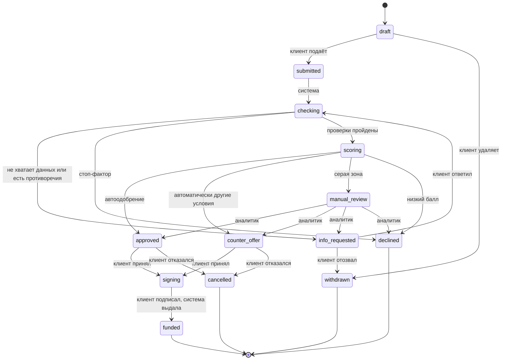
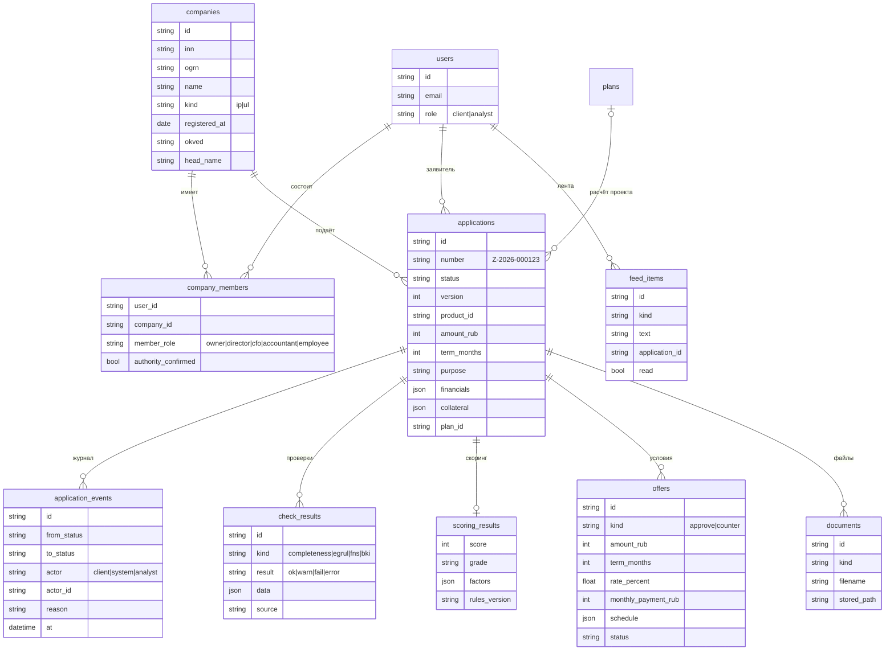
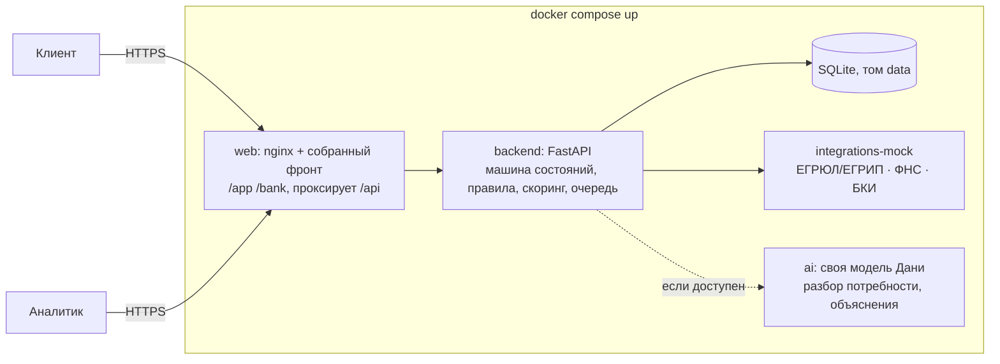

# XRONIX v2 — кредитный конвейер без ИИ

Проект основы продукта под кейс «Умный кредитный кабинет предпринимателя». Документ для всей команды: по нему пишем контракты в `contracts/` и раздаём задачи по раундам.

Принцип: **основной сценарий целиком работает без нейросети.** Все проверки, расчёты, скоринг и решения делаются правилами на бэкенде. Сверху работает собственная экспертная система Дани на правилах (раздел 13). Она понимает текст человека и ведёт диалог, но никогда не принимает кредитное решение и ничего не ломает, если недоступна. Это прямое требование кейса (с. 9: дополнительные механики «не заменяют работоспособность основного сценария»).

Как работаем: Саша с Claude пишут контракты, ставят задачи и делают фронт. Весь бэкенд, включая моки проверок, скоринг, решение и модель, делает команда бэкенда: задачи получает Илья и сам делит их с Даней. Результат Илья сдаёт Саше одним отчётом от бэкенда.

Ветки: `frontend` — Саша; `backend` — Илья, внутри него свои ветки Ильи и Дани, которые Илья сам собирает в `backend`. Отдельная ветка `ai` больше не нужна: её код уже в `dev`. Слияние в `dev` — только `frontend` и `backend`, после приёмки.

Сроки: дедлайн 26 октября. Раунды в разделе 14.

---

## 1. Что входит в MVP и что нет

Кейс просит выбрать реалистичный MVP и объяснить границы (с. 8, рекомендация 02).

**Входит:**
- кабинет клиента: компания по ИНН → потребность → подбор продукта → заявка → статус → решение → подписание → выдача (симуляция);
- расчёт проекта для цели «новая точка или направление» (наш текущий план, но по шаблонам и формулам);
- автоматические проверки: полнота и корректность, ЕГРЮЛ/ЕГРИП, «Прозрачный бизнес», БКИ — все на моках с синтетическими данными;
- балльный скоринг с объяснением каждого балла;
- логика решения отдельно от скоринга: автоодобрение, встречное предложение, запрос данных, ручное рассмотрение, отказ;
- рабочее место кредитного аналитика: очередь, карточка заявки, решение;
- журнал всех переходов (аудит), лента событий клиента;
- запуск всего одной командой `docker compose up`.

**Не входит (говорим об этом прямо в README):**
- настоящие интеграции с ФНС, БКИ, системами банка — только моки с тем же смыслом;
- настоящая электронная подпись и перевод денег — симуляция внутри продукта;
- залоговая экспертиза, юристы, комплаенс, несколько уровней одобрения — один аналитик;
- продукты «Бизнес-ипотека» и «Кредитная линия» в подборе показываем, но заявку в MVP оформляем только на два кредита одной суммой (`fast`, `secured`): для них работает аннуитетный расчёт;
- почта, SMS и мессенджеры в основном сценарии не участвуют (с. 11, ограничение 05). Все уведомления — в ленте внутри кабинета.

---

## 2. Роли

| Роль | Кто это по кейсу | Где работает |
|---|---|---|
| **Клиент-заявитель** | собственник, директор, финдиректор, бухгалтер или уполномоченный сотрудник (с. 5) | `/app` |
| **Кредитный аналитик** | сотрудник банка, разбирает заявки, которые система не решила сама | `/bank` |
| **Система** | правила конвейера: проверки, скоринг, автоматические решения | бэкенд |

Роль хранится у пользователя (`client` или `analyst`). Аналитиков создаёт сид, зарегистрироваться аналитиком нельзя.

Роль заявителя в компании спрашиваем при привязке компании. Если это не руководитель по ЕГРЮЛ, конвейер просит подтвердить полномочия (доверенность). Это деталь, которая показывает жюри, что мы учли целевую аудиторию кейса.

---

## 3. Путь клиента

Два входа: **чат подбора бизнеса** (выбрать бизнес и получить план) и **мастер заявки** (сразу к кредиту). Мастер начинается с выбора цели — три пути:

```
Чат:  идея → модель Дани уточняет сферу, город, свои деньги, анкету → план по шаблону → «Подобрать кредит» → мастер с этим планом (путь 2 или 3 без шага «Проект»)

1. Кредит для текущего бизнеса:   Цель → Компания → Что нужно → Продукт → Заявка → Статус → Решение → Подписание → Выдано
2. Новая точка или направление:   Цель → Компания → Расчёт проекта → Что нужно (сумма из расчёта) → Продукт → Заявка → …
3. Пока нет бизнеса:              Цель → Расчёт проекта → Основатель (личный ИНН) → Что нужно → Продукт «Старт» → Заявка → …
```

- Путь 2: действующий бизнес считает новую точку, сумма и срок из плана подставляются в заявку, `plan_id` уходит в заявку, прибыль проекта учитывается в нагрузке (50%).
- Путь 3: бизнеса нет, поэтому продукты Альфы (от 9 месяцев работы) не подходят. Заявка подаётся как **будущий ИП** по личному ИНН на **демо-продукт «Старт»** (раздел 6.4). При одобрении условие — зарегистрировать ИП до подписания.
- Чат — главный вход для тех, кто ещё выбирает бизнес. Модель ведёт диалог и заполняет анкету, цифры считает бэкенд по шаблонам (раздел 8). Без модели бэкенд задаёт те же вопросы сам.

### 3.1 Компания по ИНН
Клиент вводит ИНН. Фронт проверяет контрольную сумму сразу (настоящий алгоритм ФНС), бэкенд запрашивает мок ЕГРЮЛ/ЕГРИП и показывает карточку: название, ОГРН/ОГРНИП, дата регистрации, статус, ОКВЭД, адрес, руководитель. Клиент подтверждает и указывает свою роль. Повторно эти данные нигде не вводятся (кейс: «сокращать повторный ввод информации»).

### 3.2 Что нужно? (потребность)
Мастер из 2–3 шагов вместо чата:
1. Цель: пополнить оборот · купить оборудование · ремонт или открытие новой точки · новое направление бизнеса · недвижимость · рефинансировать кредиты.
2. Сумма и срок (ползунки с подсказками по диапазонам продуктов).
3. Есть ли залог (тип и примерная стоимость).

Для целей «новая точка» и «новое направление» мастер предлагает расчёт проекта (раздел 8). Итог расчёта подставляется в сумму, а прогнозная прибыль проекта учитывается в нагрузке.

### 3.3 Подбор продукта
Бэкенд сравнивает потребность со снимком продуктов Альфа-Банка (`alfaProducts.snapshot.json`). Для каждого продукта — «подходит» или «не подходит, потому что…»:
- сумма или срок вне диапазона продукта;
- продукт требует залога, а залога нет;
- стаж бизнеса меньше `minBusinessMonths` продукта (9 мес.).

Подходящие сортируются по ставке. У каждого — калькулятор платежа и предварительная нагрузка. Кнопка «Подать заявку».

### 3.4 Заявка
Форма уже заполнена из компании, потребности и продукта. Клиент дополняет только то, чего системе не хватает:
- финансы за последние 12 месяцев: выручка, расходы, ежемесячные платежи по текущим кредитам;
- залог, если продукт с залогом: тип, адрес или описание, оценочная стоимость;
- контактное лицо и его роль, подтверждение полномочий, если заявитель не руководитель (загрузка файла, любой файл в демо);
- согласие на запрос в бюро кредитных историй (галочка, симуляция).

Черновик сохраняется автоматически. Перед подачей — проверка полноты на клиенте, а затем ещё раз на сервере.

### 3.5 Статус заявки
Экран с таймлайном этапов. Для каждого статуса два текста: **«Что сейчас происходит»** и **«Что нужно от вас»** (кейс: пользователь должен понимать текущий статус и дальнейшие действия без знания внутренних процессов банка). Статус обновляется сам: фронт опрашивает `GET /api/applications/{id}` раз в 2–3 секунды, пока заявка в автоматических этапах.

### 3.6 Решение и дальше
- **Одобрено** → условия (сумма, срок, ставка, платёж, график) → «Принять» → подписание (кнопка «Подписать» с подтверждением внутри продукта) → «Выдано» (симуляция зачисления, график платежей).
- **Встречное предложение** → новые условия и объяснение, почему не исходные → «Принять» или «Отказаться».
- **Нужны данные** → что именно нужно → форма ответа → заявка возвращается на проверку.
- **Отказ** → причины понятным языком и что можно сделать (раздел 6.3).

### 3.7 Лента
Вкладка «Лента»: события по заявкам (смена статуса, запрос данных, решение) и персональные подсказки по правилам из профиля компании, например «Ваш стаж 9 месяцев — теперь вам доступен кредит без залога». Закрывает пункт с. 7 про ленту, которая меняется под клиента.

---

## 4. Состояния заявки



| Статус | Для клиента | Кто переводит дальше |
|---|---|---|
| `draft` | Черновик | клиент |
| `submitted` | Заявка принята | система, сразу |
| `checking` | Проверяем данные компании | система, 2–4 с |
| `info_requested` | Нужны данные | клиент |
| `scoring` | Оцениваем заявку | система, 2–4 с |
| `manual_review` | На рассмотрении у специалиста | аналитик |
| `approved` | Одобрено | клиент |
| `counter_offer` | Предложены другие условия | клиент |
| `signing` | Подписание | клиент |
| `funded` | Деньги выданы | конец |
| `declined` | Отказ | конец |
| `withdrawn` | Отозвана клиентом | конец |
| `cancelled` | Клиент отказался от условий | конец |

Правила:
- Переходы делает **только машина состояний на бэкенде**. Каждый переход проверяет, что он разрешён из текущего статуса и разрешён этой роли; иначе `409 INVALID_TRANSITION`.
- Каждый переход пишется в журнал `application_events`: из какого статуса, в какой, кто (клиент, система, id аналитика), причина, время.
- У заявки есть `version`. Изменения с устаревшей версией получают `409 CONFLICT`: два аналитика не примут два разных решения.
- Автоматические этапы (`submitted → checking → scoring → …`) выполняет фоновая очередь. Её можно взять из текущего механизма `generations`. Паузы по 2–4 с нужны, чтобы на демо было видно, как статус меняется.

---

## 5. Проверки и смоделированные интеграции

Отдельный сервис `integrations-mock` (свой контейнер). Бэкенд ходит в него по HTTP, как ходил бы во внешние системы. Так видно архитектуру интеграции, а моки легко заменить настоящими (кейс, с. 11: «воспроизводятся локальными моками, стабами или симуляторами»).

| Проверка | Мок чего | Что возвращает |
|---|---|---|
| Полнота и корректность | своя логика бэкенда | обязательные поля, контрольные суммы ИНН/ОГРН, сумма и срок в рамках продукта, залог есть, если нужен, сумма не больше 2 × годовой выручки |
| `GET /egrul/{inn}` | ЕГРЮЛ/ЕГРИП | статус (действует · ликвидация · ликвидирована · банкротство), дата регистрации, ОКВЭД, адрес, руководитель |
| `GET /fns/{inn}` | «Прозрачный бизнес» ФНС | массовый адрес, недоимка по налогам (сумма), дисквалификация руководителя |
| `POST /bki/report` | бюро кредитных историй | открытые кредиты и платежи по ним, просрочки 30+ и 90+ за 24 мес., длина истории |

Синтетика:
- **Именные компании для сценариев** (раздел 12) лежат в JSON-файле сервиса и дают заранее известный результат.
- **Любой другой корректный ИНН** тоже работает: данные генерируются детерминированно из хеша ИНН. Один ИНН всегда даёт одну и ту же компанию. Жюри может ввести свой ИНН, и конвейер пройдёт до конца.
- В ответе каждого мока есть поле `source` (например, `"mock-egrul v1"`). Результат каждой проверки сохраняется в `check_results` и виден аналитику.

Если мок недоступен, проверка получает статус `error`, заявка уходит в `manual_review` с пометкой. Конвейер не падает.

---

## 6. Скоринг и решение

Кейс прямо различает скоринг и кредитное решение (с. 14–15). У нас это два отдельных модуля:
- `scoring` считает балл и объясняет его;
- `decision` по баллу, стоп-факторам, продукту и сумме выбирает исход.

Все пороги и баллы лежат в одном файле правил `backend/rules/credit_rules.v1.json`. Номер версии правил сохраняется вместе с каждым решением. Это аргумент для критерия «enterprise»: правила версионируются и проверяются аудитом, а не зашиты в код.

### 6.1 Стоп-факторы (сразу отказ, без скоринга)
- компания в ликвидации, ликвидирована или в банкротстве;
- стаж бизнеса меньше минимального для продукта (9 мес.);
- просрочка 90+ дней за последние 12 месяцев;
- налоговая недоимка больше 100 000 ₽;
- руководитель дисквалифицирован.

### 6.2 Балльная карта (0–100, стартовое значение 50)

| Фактор | Условие | Баллы |
|---|---|---|
| Стаж бизнеса | 9–12 мес. / 1–3 года / больше 3 лет | 0 / +8 / +15 |
| Долговая нагрузка¹ | ≤30% / 30–50% / 50–70% / >70% | +15 / +5 / −10 / −25 |
| Кредитная история | чистая от 12 мес. / нет истории / просрочки 30+ за 24 мес. | +15 / 0 / −15 |
| Сумма к годовой выручке | ≤25% / 25–50% / 50–100% / >100% | +5 / 0 / −5 / −15 |
| Залог | покрывает ≥100% суммы / частично / нет | +10 / +5 / 0 |
| Массовый адрес | да | −10 |
| Недоимка до 100 000 ₽ | да | −10 |
| Отрасль по ОКВЭД² | повышенный риск / обычный / пониженный | −5 / 0 / +5 |

¹ Нагрузка = (платежи по текущим кредитам + платёж по новому) / среднемесячная прибыль. Прибыль = (выручка − расходы за 12 мес.) / 12. Для цели «новая точка» добавляем 50% прогнозной прибыли проекта: прогноз дисконтируем, а не верим ему целиком.

² Коэффициенты по отраслям синтетические. В README так и пишем.

Итог ограничиваем рамками 0–100. Классы: **A** ≥75 · **B** 60–74 · **C** 45–59 · **D** <45.

Пример: пекарня, 4 года (+15), нагрузка 28% (+15), чистая история (+15), сумма 20% выручки (+5), без залога, общепит (−5) → 50 + 45 = **95, класс A**.

### 6.3 Логика решения

| Ситуация | Решение |
|---|---|
| Есть стоп-фактор | `declined`, причины и что делать |
| A, сумма ≤ 5 млн ₽, нагрузка ≤ 50% | `approved` автоматически, на запрошенных условиях |
| A или B, нагрузка > 50% | `counter_offer` автоматически: сначала увеличиваем срок до максимума продукта, если не хватает — уменьшаем сумму так, чтобы нагрузка стала 50%. Если сумма падает ниже минимума продукта — `manual_review` |
| A с суммой > 5 млн ₽, или B | `manual_review`, с рекомендацией системы |
| C | `manual_review`, рекомендация «встречное предложение или залог» |
| D | `declined` |

Ставка = минимальная ставка продукта + надбавка за риск: A +0, B +1,5, C +3 п. п. (синтетика). Платёж — аннуитет, считает только бэкенд. Фронт показывает готовые цифры, чтобы расчёт не расходился.

Отказ всегда с понятными причинами и альтернативами:
- «стаж меньше 9 месяцев» → «подайте заявку после ДД.ММ.ГГГГ; пока рассмотрите собственные средства или программы поддержки МСП»;
- «высокая нагрузка» → «уменьшите сумму до N ₽ или добавьте залог»;
- «просрочки» → «закройте просрочку и подайте заявку через 3 месяца».

Это и есть «небинарный итог», о котором пишет кейс.

### 6.4 Новые предприниматели и демо-продукт «Старт»
Настоящие кредиты Альфы для бизнеса требуют 9 месяцев работы, и это правило мы не трогаем. Для тех, у кого бизнеса ещё нет, — **свой демо-продукт «Старт»**, явно помеченный «не продукт Альфа-Банка» (кейс разрешает упрощённую и явно описанную логику, с. 11). Параметры — `contracts/products.demo.json`, правила — `rules.start`, контракт — `contracts/conveyor.md`.
- Сумма 100 тыс. – 3 млн ₽, срок 6–36 мес., ставка от 27%.
- Заявка только с расчётом проекта (стоп-фактор `plan_required`), своих денег не меньше 20% запуска (стоп-фактор `own_funds_low`), нужен залог или поручитель.
- В скоринге вместо стажа — доля своих денег: от 40% — +15, 30–40% — +8, 20–30% — 0. Прибыль для нагрузки — 50% плановой, выручка — годовая по плану.
- Заявитель — будущий ИП (компания `kind = person` по личному ИНН). Проверка БКИ по личному ИНН, ЕГРЮЛ не нужен. В одобрении — условие зарегистрировать ИП до подписания.

Так путь «выбрал бизнес → получил кредит» работает целиком, а настоящие продукты банка остаются честными.

---

## 7. Рабочее место аналитика (`/bank`)

- **Очередь**: заявки по статусам, фильтры, сортировка по времени ожидания, «мои» и «все».
- **Карточка заявки**:
  - данные компании и заявителя;
  - запрошенные условия;
  - финансы;
  - результаты каждой проверки (зелёный, жёлтый, красный) с источником;
  - скоринг: балл, класс и таблица «фактор → значение → баллы»;
  - рекомендация системы;
  - журнал переходов.
- **Действия**: одобрить (можно поправить сумму, срок, ставку в рамках продукта) · встречное предложение · запросить данные (выбор из списка плюс свободный текст) · отказать (причина из справочника и комментарий). Комментарий обязателен при отказе и встречном предложении.
- **Сводка** (если успеем): число заявок по статусам, доля автоматических решений, среднее время до решения.

Аналитик не может изменить данные клиента, только принять решение. Все действия попадают в журнал.

---

## 8. Расчёт проекта без ИИ

Наш экран плана (шаги, смета, прогноз на 12 месяцев, риски, график) сохраняем, но данные даёт **шаблон по сфере + формулы**, а не модель. Формат ответа — тот же `plan.schema.json` со сметами `startup_items` и `monthly_items`.

- Шаблоны: [`contracts/templates/spheres.v1.json`](../contracts/templates/spheres.v1.json) — вопросы анкеты, статьи запуска, месячные расходы, модель выручки, разгон, возможности, риски.
- Формулы: [`contracts/templates.md`](../contracts/templates.md). Эталонная реализация — `frontend/src/lib/projectCalc.ts`, бэкенд повторяет её по формулам. Пример запроса и ответа — в `contracts/examples/plan.calc.*.json`; ответ проходит `check_plan` бэкенда, а `recalculate` не меняет в нём ни одного числа.
- Коэффициент города по населению из `cities.json`: Москва 1,0 · Санкт-Петербург 0,8 · миллионники 0,55 · от 250 тыс. 0,45 · остальные 0,35. Город не найден — 0,45.
- Сферы: кофейня, пекарня, автомойка, магазин одежды, салон красоты, пункт выдачи заказов.
- Значения подобраны так, чтобы в Москве по умолчанию выходило 15–20% маржи и 9–20 месяцев окупаемости. В регионах дешевле аренда и зарплаты, а поток клиентов по умолчанию тот же — человек правит его сам. Все цифры синтетические, в README так и пишем.

Окупаемость, прибыль и смета считаются в одном месте, поэтому текст плана всегда совпадает с цифрами.

---

## 9. Модель данных



Таблицы `plans`, `users`, сессии и восстановление пароля переиспользуем. Чаты и генерации остаются в коде, но в основном сценарии v2 не участвуют (раздел 13).

---

## 10. API (черновик, точные схемы — в `contracts/`)

**Клиент**

| Метод и путь | Что делает |
|---|---|
| `GET /api/registry/{inn}` | предпросмотр компании из мока ЕГРЮЛ/ЕГРИП |
| `POST /api/companies` | привязать компанию к пользователю: `{inn, member_role}` |
| `GET /api/companies` | мои компании |
| `GET /api/templates` · `POST /api/plans/calculate` | список сфер · расчёт проекта по анкете |
| `POST /api/products/match` | подбор: `{purpose, amount_rub, term_months, collateral, company_id}` → продукты с «подходит/почему нет» и платежом |
| `POST /api/applications` | создать черновик |
| `PATCH /api/applications/{id}` | изменить черновик или ответить на запрос данных (с `version`) |
| `POST /api/applications/{id}/submit` | подать |
| `GET /api/applications` · `GET /api/applications/{id}` | список · заявка с таймлайном, текущими условиями и «что нужно от вас» |
| `POST /api/applications/{id}/accept` · `/reject-offer` · `/sign` · `/withdraw` | действия клиента |
| `POST /api/applications/{id}/documents` | загрузить файл |
| `GET /api/feed` · `POST /api/feed/read` | лента |

**Аналитик** (только роль `analyst`, иначе `NOT_FOUND`)

| Метод и путь | Что делает |
|---|---|
| `GET /api/bank/applications?status=` | очередь |
| `GET /api/bank/applications/{id}` | карточка: проверки, скоринг, журнал, рекомендация |
| `POST /api/bank/applications/{id}/decision` | `{kind: approve\|counter\|decline\|request_info, amount_rub?, term_months?, rate_percent?, reasons[], comment, version}` |
| `GET /api/bank/stats` | сводка |

Новые коды ошибок: `INVALID_TRANSITION` (409), `CONFLICT` (409), `FORBIDDEN_ROLE` (404 по нашему правилу «чужое не существует»).

FastAPI уже генерирует OpenAPI. В репозиторий кладём выгрузку `contracts/openapi.json` и коллекцию запросов `contracts/collection/` (Bruno), чтобы жюри могло пройти сценарий без интерфейса.

---

## 11. Архитектура и запуск



- Корневой `docker-compose.yml`: `web`, `backend`, `integrations-mock`, `ai`. Сервис `ai` с моделью Дани входит в обычный запуск, работает на процессоре. Если он не поднялся или не ответил за 10 с, бэкенд продолжает без него.
- `docker compose up` → `http://localhost:8080`, сиды применяются при первом запуске.
- Прод-конфигурации Ильи (Caddy, бэкапы, ограничения) остаются в `backend/deploy/` для xronix.ru.
- SQLite оставляем: для MVP достаточно, миграции уже есть. В README пишем, что для продакшена заменяется на PostgreSQL без изменения API — модели на SQLAlchemy.

---

## 12. Синтетические данные и сценарии для жюри

**Учётные записи** (в README):
- `client@xronix.demo` / `demo12345` — клиент, у него уже две компании и заявки в разных статусах;
- `analyst@xronix.demo` / `demo12345` — аналитик;
- новый клиент регистрируется сам.

**Компании-сценарии** (ИНН с корректной контрольной суммой, выдуманные):

| Компания | Что внутри | Чем закончится |
|---|---|---|
| ООО «Северная выпечка», 4 года | чистая история, нагрузка низкая | автоодобрение |
| ИП Лебедев, 2 года, кофейни | открывает вторую точку, нагрузка 62% | встречное предложение: дольше срок |
| ООО «Вектор Логистик», 6 лет | сумма 12 млн | ручное рассмотрение аналитиком |
| Будущий ИП, личный ИНН `772519083310` | кофейня из чата, своих 500 тыс., поручитель | «Старт»: одобрение или встречное предложение с условием регистрации ИП |
| ООО «Ромашка Трейд» | просрочка 90+ | отказ с объяснением |
| ИП Соколова, 5 месяцев | стаж меньше 9 месяцев | отказ по продукту и альтернативы |
| ООО «Альфа-Сервис Плюс» | массовый адрес, заявитель — бухгалтер | запрос данных: доверенность |

Сид также создаёт 10–15 заявок во всех статусах, чтобы очередь аналитика не была пустой.

**Сценарий проверки для README** (10 минут): войти клиентом → компания «Северная выпечка» → цель «оборудование», 1,5 млн, 24 мес. → подбор → заявка → статус меняется сам → одобрено → подписать → выдано. Затем ИП Лебедев → встречное предложение. Затем войти аналитиком → взять «Вектор Логистик» → посмотреть проверки и скоринг → одобрить с изменённой суммой → вернуться клиентом и увидеть решение в ленте.

---

## 13. Своя экспертная система Дани

> **Решение 21 октября.** Вместо дообучения нейросети (Qwen3 + LoRA) сервис `ai` — собственная экспертная система на правилах: словари, разбор текста и чисел, шаблоны ответов. Она уже принята в раунде 2. В раунде 3 к ней добавляются база знаний о городах из открытых источников и банк фраз, сгенерированный GigaChat при разработке и вычитанный командой (`contracts/ai.md`, «База знаний и банк фраз»). В проверяемой версии нет нейросети, ключей и внешних API. Ниже — исходный план с моделью, он сохранён для истории; требования к качеству из 13.3 (пороги точности, отложенная выборка) действуют и для системы правил.

Вместо прямых запросов к GigaChat Даня обучает собственную узкую модель. GigaChat Ultra используется только при разработке: генерирует и размечает обучающие данные. В проверяемой версии GigaChat нет, работает только наша модель с открытыми весами (с. 10–11: без платных API, только открытые веса).

### 13.1 Что модель делает и чего не делает

| Задача | Без модели (основа) | С моделью |
|---|---|---|
| **Чат подбора бизнеса** (`/ai/consult`) — главная задача | бэкенд по очереди спрашивает сферу, город и свои деньги | модель ведёт живой диалог, понимает идею своими словами, уточняет анкету, отвечает на вопросы про бизнес |
| Разбор фразы в мастере (`/ai/parse-need`) | клиент заполняет мастер руками | клиент пишет своими словами, модель заполняет мастер, клиент проверяет и правит |
| Объяснение решения | текст из шаблонов по факторам скоринга | понятный текст и советы по тем же факторам |
| Сводка для аналитика (если успеем) | таблица проверок и баллов | короткая сводка «на что обратить внимание» |

**Модель никогда не принимает кредитное решение и не считает деньги.** Скоринг и решение — правила из раздела 6: их можно объяснить по пунктам, и так их описывает сам кейс (с. 14–15). Объяснение модель пишет только по уже посчитанным факторам и не может добавить новых причин.

### 13.2 Разбор потребности

`POST /ai/parse-need` (точный контракт — в `contracts/ai.md`)

Вход: `{ "text": "Хочу открыть вторую кофейню в Казани, нужно около полутора миллионов на оборудование и ремонт" }`

Выход:
```json
{
  "purpose": "new_location",
  "sphere": "coffee",
  "city": "Казань",
  "amount_rub": 1500000,
  "term_months": null,
  "has_collateral": null,
  "confidence": { "purpose": 0.94, "sphere": 0.97, "city": 0.99, "amount_rub": 0.9 }
}
```

Значения `purpose` и `sphere` — только из справочников конвейера. Чего нет в тексте, то `null`. Бэкенд проверяет ответ по схеме. Поля с уверенностью ниже 0,7 мастер подсвечивает и просит подтвердить.

### 13.3 Требования к модели
- **Лицензии проверить первым делом, до траты токенов.** Условия GigaChat API должны разрешать обучение других моделей на его ответах. Если не разрешают — генерировать данные открытой моделью GigaChat 3 (если её веса открыты) или другой открытой моделью. База для дообучения — с открытой лицензией, например Qwen3 (Apache 2.0).
- **Размер — до ~2 млрд параметров**, в сжатом виде. У жюри должна отвечать на процессоре за 1–3 с.
- **Датасет:** синтетические запросы предпринимателей (разные сферы, города, суммы прописью и цифрами, опечатки, разговорный стиль) с разметкой по схеме. Каждый пример проверяется схемой. Часть — неоднозначные и бессмысленные запросы с ответом `null`.
- **Отложенная выборка не меньше 200 примеров**, которых модель не видела при обучении. На ней считаем точность по каждому полю.
- **Порог для слияния в `dev`:** `purpose` и `sphere` ≥ 90%, `amount_rub` ≥ 90%, `city` ≥ 95%. Не прошла — остаётся в ветке `ai`, конвейер работает без неё.
- **Обучение** на RTX 5070 Ильи (LoRA), упаковка в контейнер `ai`. Веса в `ai/models/` через Git LFS или скачиваются при сборке образа.
- **Воспроизводимость:** скрипты генерации датасета, обучения и оценки лежат в репозитории. Датасет и отчёт об оценке — тоже. Это аргумент для критерия «Потенциал развития».

### 13.4 Что Даня присылает в отчёте
1. Подтверждение лицензий: GigaChat API, базовая модель, итоговые веса.
2. Размер датасета, как генерировали и как проверяли.
3. Метрики на отложенной выборке по каждому полю и 10 примеров ошибок.
4. Время ответа на процессоре: среднее и 95-й перцентиль.
5. Работающий `/ai/parse-need` в контейнере и прогон контрактных тестов.

---

## 14. Раунды и распределение

Дедлайн 26 октября. Каждый раунд: задачи → работа в своих ветках → отчёты Саше → проверка → слияние в `dev`.

**Раунд 0 — контракты (20 октября, Саша + Claude).** Схемы в `contracts/`: заявка, статусы и переходы, проверки, скоринг, решение, условия, API клиента и банка, ошибки, контракт модели `/ai/parse-need`, справочники, файл правил `credit_rules.v1.json`. Готово.

Ниже задачи бэкенда даны одним списком: как делить их между собой, решает Илья.

**Раунд 1 (20–21 октября)**
- **Бэкенд:** модели и миграции; машина состояний с журналом и `version`; API заявок клиента, включая будущего ИП; очередь автоматических этапов; сервис `integrations-mock`; модули скоринга и решения по файлу правил, включая «Старт», с тестами; проверка лицензий, выбор базовой модели и датасет для `/ai/consult` и `/ai/parse-need`.
- **Фронт:** компания по ИНН, мастер потребности, подбор продукта, форма заявки, экран статуса на моках фронта по контрактам.

**Раунд 2 (22–23 октября)**
- **Бэкенд:** скоринг и решение в конвейере; API аналитика и роли; сид данных и учёток; `GET /api/templates` и `POST /api/plans/calculate` строго по `contracts/templates.md` (раздел 8); чат подбора бизнеса на `/ai/consult` с запасным диалогом без модели; дообучение модели, оценка, сервис `ai` в контейнере (отчёт по пункту 13.4); корневой `docker-compose.yml`.
- **Фронт:** экраны решения, подписания и выдачи; рабочее место `/bank`; переход с моков на настоящий бэкенд.

**Раунд 3 (24 октября)**
- **Бэкенд:** лента событий; `POST /api/needs/parse` с таймаутом и запасным путём; доработка модели по ошибкам; выгрузка OpenAPI и коллекция запросов; падающий тест сброса пароля.
- **Фронт:** поле «опишите своими словами» на настоящей модели, лента, обновление лендинга под конвейер, схемы для README.
- **Все:** README, `THIRD_PARTY_NOTICES` (в том числе базовая модель, датасет, GigaChat как инструмент разработки), сценарии проверки.

**Раунд 4 (25 октября)**
- Сквозной прогон всех сценариев раздела 12 на чистой машине через `docker compose up`, с моделью и без неё.
- Исправление найденного. Новых функций не начинаем.

**26 октября:** заморозка, `dev` → `main`, тег `v1.0`, доступ `alfa-hack-2026`, проверка, что публичное демо работает.

Если модель не проходит порог к концу раунда 3, она не попадает в сдачу. Конвейер сдаётся без неё, а в презентации показываем датасет, метрики и план доработки.

---

## 15. Что решить команде

1. ~~Чат убираем~~ — решено: чат остаётся главным входом для подбора бизнеса (раздел 3), демо-продукт «Старт» для нового бизнеса (раздел 6.4).
2. Порог автоодобрения 5 млн ₽ и надбавки к ставке — синтетика. Нужны ли другие значения для демо?
3. Публичное демо на xronix.ru переводим на v2 сразу после раунда 2 или в конце?
4. Кто готовит презентацию и видео-прохождение, если жюри не сможет запустить?
